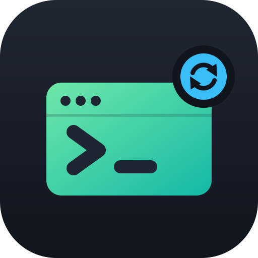

<p align="center"></p>

<h1 align="center">dotfiles</h1>

<p align="center">One small, fast zsh setup for every machine I use: Mac, Linux, or a cluster without sudo.</p>

---

My shell config, managed with [chezmoi](https://www.chezmoi.io/). One command sets up a new machine: it installs the tools, writes the config, and decrypts the private bits. It behaves the same on macOS, Linux with Homebrew, and shared Linux boxes where there's no brew and no sudo.

## What you get

| | What it's for | Tools |
| --- | --- | --- |
| **Prompt** | path, git status, slow-command timer, hostname over SSH | [Starship](https://starship.rs) |
| **Typing help** | syntax colors, grey suggestions from history, live completion menus | [fast-syntax-highlighting](https://github.com/zdharma-continuum/fast-syntax-highlighting), [zsh-autosuggestions](https://github.com/zsh-users/zsh-autosuggestions), [zsh-autocomplete](https://github.com/marlonrichert/zsh-autocomplete) |
| **Getting around** | fuzzy history and file search, `z <name>` to jump to frequent folders | [fzf](https://github.com/junegunn/fzf), [zoxide](https://github.com/ajeetdsouza/zoxide) |
| **Everyday CLI** | nicer `ls`, `cat`, `grep`, `find`, `du`, `df`, `top`, JSON | [eza](https://github.com/eza-community/eza), [bat](https://github.com/sharkdp/bat), [ripgrep](https://github.com/BurntSushi/ripgrep), [fd](https://github.com/sharkdp/fd), [dust](https://github.com/bootandy/dust), [duf](https://github.com/muesli/duf), [btop](https://github.com/aristocratos/btop), [jq](https://jqlang.org) |
| **Git** | readable diffs, GitHub sign-in, large files | [delta](https://github.com/dandavison/delta), [gh](https://cli.github.com), [git-lfs](https://git-lfs.com) |
| **Terminal** | GPU terminal with a Nerd Font (macOS), sessions that survive disconnects | [Ghostty](https://ghostty.org), [tmux](https://github.com/tmux/tmux) |
| **Managed by** | one command per machine, encrypted secrets | [chezmoi](https://www.chezmoi.io), [age](https://age-encryption.org) |

## Quick start

```sh
sh -c "$(curl -fsLS get.chezmoi.io)" -- init --apply Syzygianinfern0
```

You'll be asked for the passphrase that unlocks the encrypted files. Then sign in to GitHub once with `gh auth login`, and make zsh your shell if it isn't already: `chsh -s "$(command -v zsh)"`.

On a bare container, install the basics first: `apt update && apt install -y git curl zsh`.

To pull in later changes: `chezmoi update`.

## Learn more

- [Using it](docs/usage.md): shortcuts, aliases, and the everyday chezmoi commands
- [How tools get installed](docs/bootstrap.md): Homebrew vs. the no-sudo fallback, and a map of the repo
- [Git setup](docs/git.md): the defaults, delta, and GitHub sign-in
- [Secrets](docs/secrets.md): what's encrypted and how the key works
- [AI coding agents](docs/ai.md): shared instructions and skills for Claude Code and Codex, their settings, and `chat2md`

The old oh-my-zsh + Powerlevel10k setup lives on the [`pre-starship`](https://github.com/Syzygianinfern0/dotfiles/tree/pre-starship) branch.
